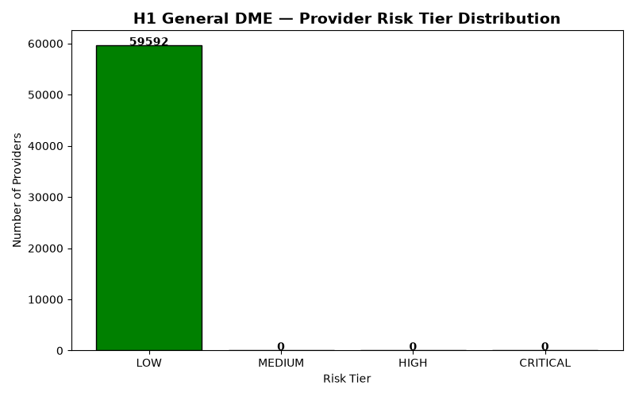

# CAET: Claims Auditing Enhancement Tool
**Author:** Dr. S. L. Toriola, MD, MSc.

**Goal:** Learn healthcare claims fraud analytics and compliance analytics by building statistical software in Python (pandas), matplotlib/seaborn, and Power BI.

**Project:**
- Asks: Can statistical fraud signals alone separate legitimate
  high-volume DME providers from fraud rings?
- New insight: Applying future member claims denial accuracy with integrated caller input that feeds the AI screen after call and case completion.
- Provides: two risk-scoring models (H1 general DME, H2 intermittent
  catheters), tiered composite scores, a member-call amplifier
  (simulated calls), charts, and a Power BI dashboard.
- Results: H1: 0% of 59,592 providers HIGH/CRITICAL on signals alone.
  H2: 8 of 41 (19.5%) HIGH vs a 75% target, not met.

**Project Logistics:**
- Structure: `CAET_tool/` (scripts, run in step order), `visuals/`,
  `dashboard/`, `docs/` (methodology)
- Data: CMS Medicare DME Supplier/Provider 2023 (463,784 rows);
  CSVs are gitignored
- Key vocab (parameters measured):
  - Charge-to-allowed ratio: upcoding signal
  - Claims per beneficiary: volume signal
  - Geography: high-risk states, state volume outliers
  - Rental ratio: rental abuse signal
  - Catheter bundling: H2-specific signal
  - Member-call score: complaint-based amplifier
  - Composite score and tiers: LOW <40, MEDIUM 40, HIGH 60, CRITICAL 80

## Featured Visuals

## Dashboard

[View Dashboard (PDF)](dashboard/CAET_PowerBI_visual.pdf)

## Full Methodology

[View full methodology](docs/caet_data_visualization_outline_v1.0.md)
