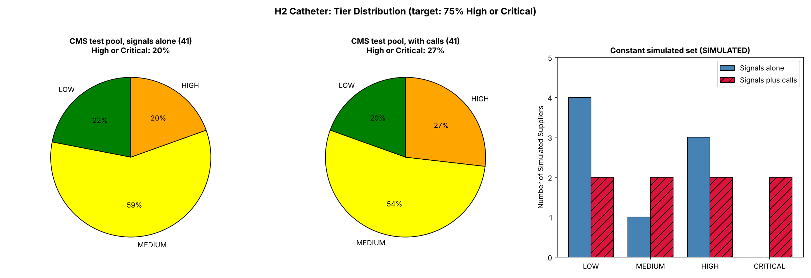

# CAET — Claims Auditing Enhancement Tool

**Summary:** CAET (Claims Auditing Enhancement Tool) is a Python-based fraud risk-scoring system for DME medical claims, using signal detection and composite scoring to flag high-risk suppliers/providers.

**Question:** Can statistical fraud signals alone distinguish legitimate high-volume providers from fraud rings?

**Method:** Two hypothesis-tested models (general DME, catheter-specific), tiered scoring, member-call amplifier, CMS Medicare DME Supplier/Provider 2023 dataset.

**Results:** H1 0% baseline hit rate / H2 19.5% — both confirming the call amplifier is required, not a failure.

**Tech stack:** Python, pandas, matplotlib/seaborn, Power BI

## Featured Visuals

## Dashboard

[View Dashboard (PDF)](dashboard/CAET_PowerBI_visual.pdf)

## Repo Structure
/src — source code
/visuals — chart PNGs
/dashboard — Power BI PDF export
/docs — methodology and supporting docs

## Full Methodology

[View full methodology](docs/CAET_Methodology.txt)

---

**Author:** Dr. Stacy Lisa Toriola, MD, MSc.
