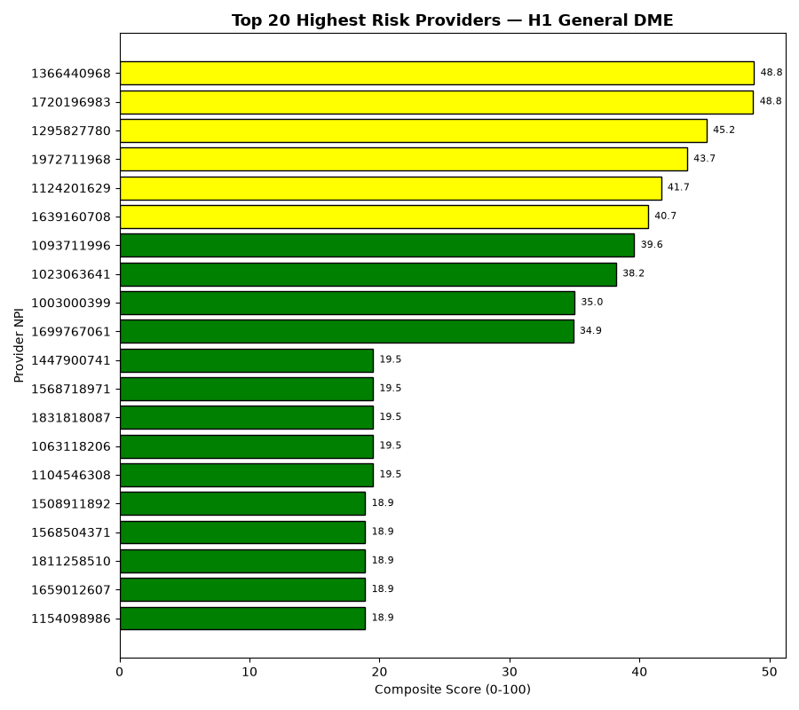
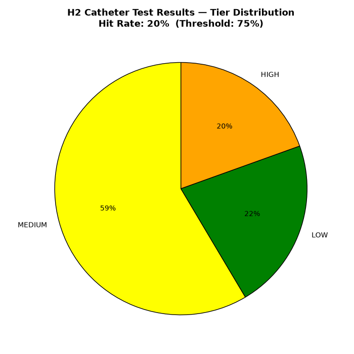

# CAET: Claims Auditing Enhancement Tool
**Author:** Dr. S. L. Toriola, MD, MSc.

**Goal:** Learn healthcare claims fraud analytics and compliance analytics by building statistical software in Python (pandas), matplotlib/seaborn, and Power BI.

**Project:**
- Asks: Can statistical fraud signals alone separate legitimate
  high-volume DME providers from fraud rings?
- New insight: Applying future member claims denial accuracy with integrated caller input that feeds the AI screen after call and case completion.
- H1 (General DME): tests all 59,592 suppliers across every equipment type. Pass = 70% or more score HIGH or CRITICAL.
- H2 (Intermittent catheters): tests the 41 catheter suppliers in OK, FL, NY, TX, GA (of 206 billing 8+ catheter codes), adding a bundling signal. Pass = 75% or more.
- A "hit" = scored HIGH or CRITICAL. It means flagged for review, not confirmed fraud.
- Why H2: catheter fraud can go undetected in general DME scoring, because category weights and pooled cutoffs dampen it. H2 uses catheter-specific cutoffs and bundling signals. Basis: author's claims-adjustment experience and CMS data.
- Provides: two risk-scoring models (H1 general DME, H2 intermittent
  catheters), tiered composite scores, a member-call amplifier
  (simulated calls), charts, and a Power BI dashboard.
- Results: H1: 0% of 59,592 providers HIGH/CRITICAL on signals alone.
  H2: 8 of 41 (19.5%) HIGH vs a 75% target, not met.

**Project Logistics:**
- Structure: `CAET_tool/` (scripts, run in step order), `visuals/`,
  `dashboard/`, `docs/` (methodology)
- Data: CMS Medicare DME by Supplier and Service, 2023 (463,784 rows);
  CSVs are gitignored
- Key vocab (parameters measured):
  - Charge-to-allowed ratio: upcoding signal
  - Claims per beneficiary: volume signal
  - Geography: high-risk states, state volume outliers
  - Rental ratio: rental abuse signal
  - Catheter bundling: H2-specific signal
  - Category risk weight: CMS improper-payment-rate multiplier; can mask low-weight categories like catheters in H1
  - Catheter-specific cutoffs: H2 thresholds, used to avoid that masking
  - Member-call score: complaint-based amplifier
  - Composite score and tiers: LOW <40, MEDIUM 40, HIGH 60, CRITICAL 80
  - Override floor: minimum H2 score (65 or 42) for strong bundling flags
- Run order (`CAET_tool/`, run from that folder):

  | Step | File | What it does |
  |---|---|---|
  | 1 | `step1_load_data.py` | Loads CMS data, adds signals and category weights |
  | 4 | `step4_thresholds.py` | Prints general and catheter percentiles |
  | 5, 7, 8 | `step5_...`, `step7_...`, `step8_...` | Upcoding, geographic, member-call scorers |
  | 9 | `step_rental_scorer.py`, `step9b_composite_h1.py` | Rental scorer, H1 composite |
  | 10 | `step10_h1_test.py` | H1 test (baseline, plus with-calls if step 16 was run) |
  | 11, 12, 13 | `step11_...`, `step12_...`, `step13_...` | Catheter candidates, bundling, H2 composite |
  | 15 | `step15_h2_test.py` | H2 test |
  | 16 | `step16_member_call_integration.py` | Applies simulated member calls |
  | check | `validate_caet.py` | Reconciles outputs |
  | shared | `caet_shared.py` | Shared weights, H2 cutoffs, override floor |

## Featured Visuals

## Dashboard

[View Dashboard (PDF)](dashboard/CAET_PowerBI_visual.pdf)

## Full Methodology

[View full methodology](docs/caet_data_visualization_outline_v1.0.md)
