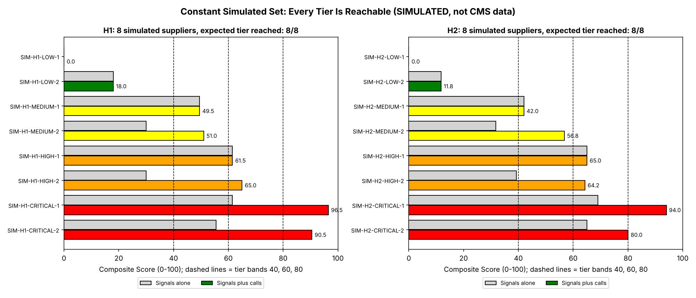
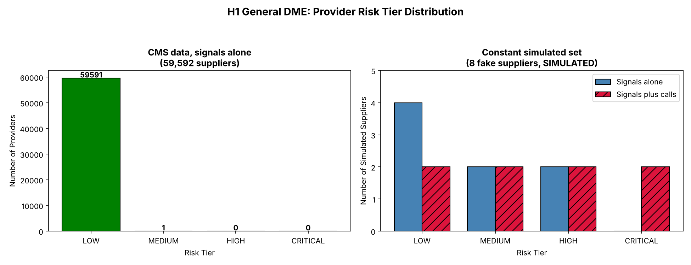
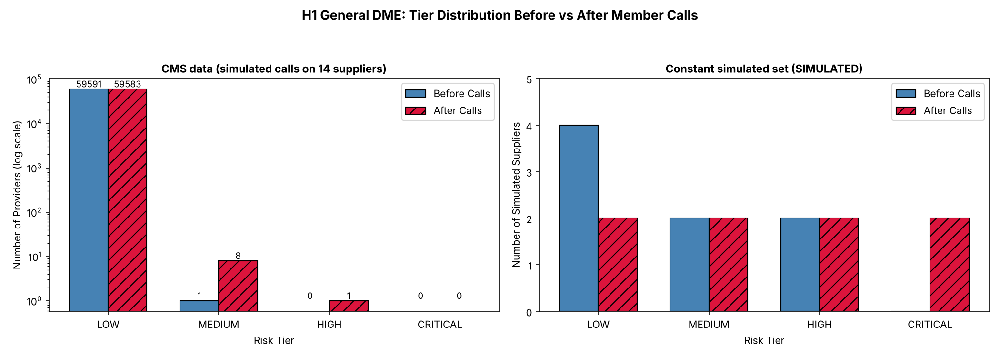
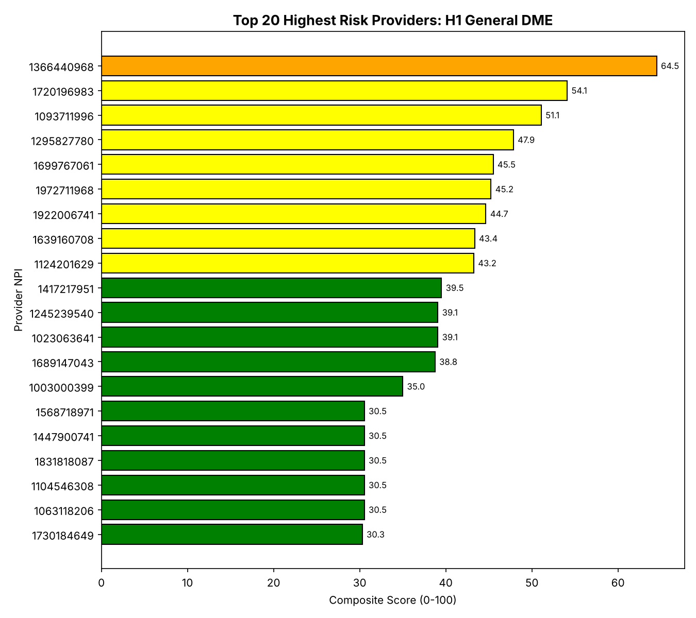
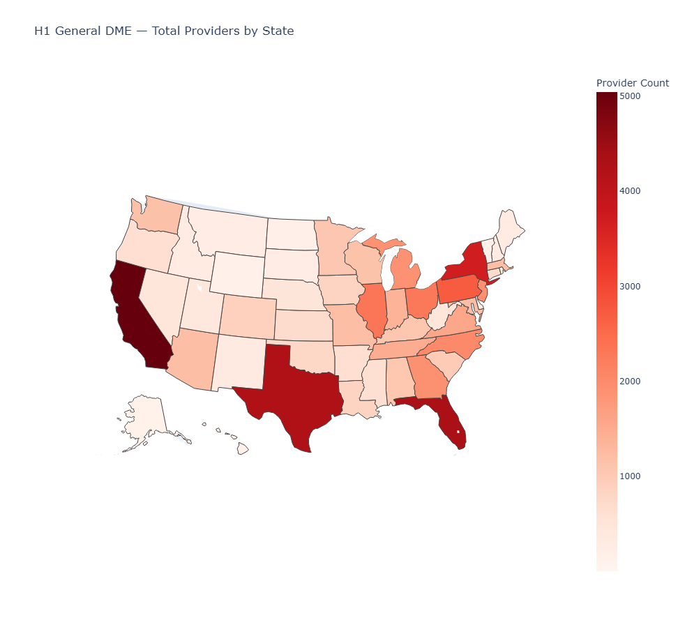
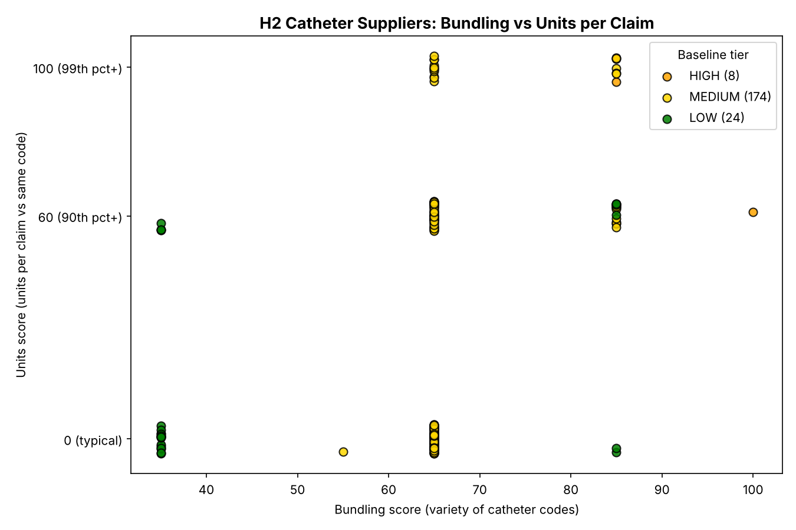
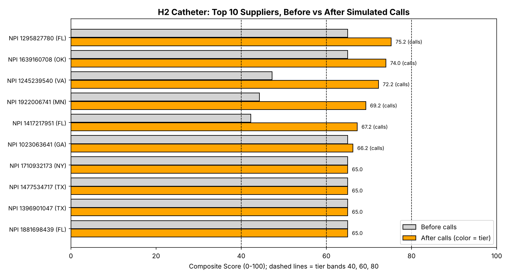
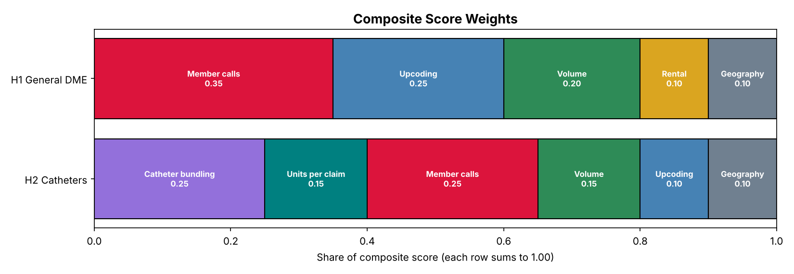

# CAET: Claims Auditing Enhancement Tool
**Author:** Dr. S. L. Toriola, MD, MSc.

**Goal:** Learn healthcare claims fraud, waste, and abuse (FWA) and compliance analytics by building statistical software in Python (pandas), matplotlib/seaborn, and Power BI.

## Start Here (plain-language guide)

- **DME** = Durable Medical Equipment: items a doctor orders for home use, such as catheters, CPAP machines, wound dressings, braces.
- **Supplier** = the business that bills Medicare for that equipment.
- **Signal** = a number that looks unusual compared with other suppliers, such as billing far above what Medicare allows.
- **Score** = signals combined into one number from 0 to 100. Higher means more worth a second look.
- **Tier** = a label for the score: LOW (under 40), MEDIUM (40), HIGH (60), CRITICAL (80).
- **Member call** = a Medicare member phoning in a complaint about a supplier, such as "I never received this item."
- **Hit** = scored HIGH or CRITICAL. It means flagged for review, not confirmed fraud.

## Project

**What it asks**
- Can billing signals and member calls help an auditor decide which suppliers to review first?
- Which suppliers should an auditor review first, based on billing patterns and member complaints?
- Do billing signals alone, or billing signals plus member calls, identify high-risk suppliers?

**H1: Hypothesis 1 of 2 (General DME, signals alone)**
- Tests all 59,592 suppliers across every equipment type.
- H1 = signals alone, at any tier (LOW, MEDIUM, HIGH, CRITICAL). The with-calls run then adds member calls.
- Target: 70% or more of tested suppliers reach HIGH or CRITICAL.

**H2: Hypothesis 2 of 2 (Intermittent urinary catheters, signals plus calls)**
- Tests the 41 catheter suppliers in OK, FL, NY, TX, GA, picked from the 206 that bill 8 or more catheter codes.
- H2 = catheter signals (bundling and units per claim) plus calls, at any tier.
- Target: 75% or more reach HIGH or CRITICAL.

**Why H2 exists**
- Catheter fraud can go undetected inside general DME scoring, because one pooled cutoff and the category weight shrink catheter scores.
- H2 uses catheter-specific cutoffs and two billing signals: bundling (many different catheter codes) and units per claim (maximum units of the same code).
- Claims show what was billed. Only member calls show what was received.
- Basis: the author's claims-adjustment experience and CMS data.

**Thesis: phantom billing and medical necessity fraud**
- **Definition:** claims are billed at the correct contracted or fee-schedule rate, but the patient never ordered, received or needed the item.
- **Why payment checks miss it:** the amount is accurate, so expected-versus-actual payment models see nothing wrong.
- **Secondary-payer gap (hypothesis):** when Medicare pays first, a secondary commercial payer may accept the crossover claim without a separate prior authorization. Medicare's payment then acts as an implicit validation, and neither payer independently checks necessity.
- **CAET controls:** member calls (simulated here) and peer-based utilization signals (units per claim, volume, bundling).

**What it provides**
- Two risk-scoring models (H1 and H2) with tiered composite scores.
- A member-call amplifier, run here on 41 simulated calls.
- Charts, a Power BI dashboard, and a methodology document.

**Results**

*Constant simulated set* (16 fake suppliers, two per tier for each hypothesis, fixed signal values, not CMS data)
- 16 of 16 land in the expected tier, so every tier (LOW, MEDIUM, HIGH, CRITICAL) is reachable for H1 and H2.

*Experimental run* (full CMS 2023 data)

| Test | Signals alone | Signals plus simulated calls |
|---|---|---|
| H1, 59,592 suppliers | 0 HIGH or CRITICAL (top score 43.5) | 1 HIGH, 8 MEDIUM |
| H2, 41 suppliers | 8 HIGH, 24 MEDIUM, 9 LOW (19.5% HIGH) | 11 HIGH, 22 MEDIUM, 8 LOW (26.8% HIGH) |

- Calls move suppliers up a tier, which is what the amplifier is built to do.
- Four top-units suppliers have simulated calls (billed at maximum units, members report not receiving supplies). Others with top units scores have no calls and stay at their billing-only tier.
- Simulated calls cover 14 suppliers only, so these numbers show how the tool behaves, not real fraud rates.

## Future Work

- Add crossover and secondary-payer claim data, which public CMS data does not include.
- Add a signal for suppliers with high catheter utilization and mostly crossover claims.
- Test whether Medicare-paid claims pass secondary review at a different rate than other claims.
- Add a diagnosis-to-item fit signal, which needs diagnosis data that the CMS supplier file does not carry.
- Add plan-level checks for eligibility, authorization and frequency limits.
- Add an optional payment-integrity extension that validates contract and fee-schedule amounts, kept separate from the fraud track.

## Foundation

**Structure**
- `CAET_tool/` holds the scripts, run in step order.
- `visuals/`, `dashboard/`, `docs/` hold charts, the Power BI PDF, and the methodology.

**Data**
- CMS Medicare DME by Supplier and Service, 2023: 463,784 rows, 59,592 suppliers.
- CSV files are gitignored. Place `master_set_cms_medicare_dme_2023.csv` inside `CAET_tool/` before running.

**Variables measured (what Python calculates)**

| Variable | Where it comes from | What it means |
|---|---|---|
| `charge_to_allowed_ratio` | Submitted charge divided by Medicare allowed amount | Upcoding signal: how far billing exceeds what Medicare allows |
| `claims_per_bene` | Total claims divided by total beneficiaries | Volume signal: how often the same patient is billed |
| `payment_delta` | Allowed amount minus Medicare payment | Gap between what was allowed and what was paid |
| `geo_standardization_delta` | Medicare payment minus standardized amount | Regional price adjustment |
| `fraud_hcpcs_cat` | HCPCS code (the item billed) grouped into a category | Dressing, orthotic, CGM, catheter, CPAP, or other |
| `category_risk_weight` | Fixed CMS improper-payment-rate number per category | Multiplier on row scores, divided by the highest weight so the top category is 1.0. Dressings 1.000, orthotic 0.891, CGM 0.438, catheter 0.313, CPAP 0.217, other 0.174 |
| `rental_ratio` | Rental rows divided by all rows for a supplier | Rental abuse signal |
| `geo_score` | State and RUCA (urban or rural code) | High-risk states +30, urban +15, state outlier +20 |
| `bundling_score` | Count and mix of catheter codes per supplier | H2 signal: 14 or more codes scores highest |
| `units_score` | Services divided by claims, compared with the same HCPCS code | H2 signal: billing at the maximum units. 60 points at the code's 90th percentile, 100 at the 99th |
| `member_call_score` | Call reason and number of distinct members | Complaint amplifier, capped at 100 |
| `composite_score` | Weighted blend of the signals above | The final 0 to 100 score. H2 weights: bundling 0.25, units 0.15, calls 0.25, volume 0.15, upcoding 0.10, geo 0.10 |
| Cutoffs (90th and 99th percentile) | Calculated from the full CMS data in step 4 | A row earns 60 points above the 90th, 100 above the 99th |
| Override floor | Rule in `caet_shared.py` | Minimum H2 score (65 or 42) when bundling is extreme or high |

**Files and what each does**

| Step | File | What it does |
|---|---|---|
| 1 | `step1_load_data.py` | Loads the CMS file, adds ratios, categories, and category weights |
| 4 | `step4_thresholds.py` | Prints general and catheter percentile cutoffs |
| 5 | `step5_upcoding_scorer.py` | Scores charge-to-allowed ratio |
| 7 | `step7_geo_scorer.py` | Scores state and urban risk |
| 8 | `step8_member_call_scorer.py` | Empty member-call scorer, all zeros until calls are added |
| 9 | `step_rental_scorer.py` | Scores rental abuse |
| 9b | `step9b_composite_h1.py` | Combines signals into the H1 score and tier |
| 10 | `step10_h1_test.py` | H1 test: hit rate against the 70% target, with and without calls |
| 11 | `step11_identify_catheter_providers.py` | Finds the 206 suppliers billing 8 or more catheter codes |
| 12 | `step12_catheter_bundling_scorer.py` | Scores catheter bundling |
| 13 | `step13_catheter_composite.py` | Scores units per claim, combines H2 signals, applies the override floor |
| 15 | `step15_h2_test.py` | H2 test: hit rate against the 75% target |
| 16 | `step16_member_call_integration.py` | Applies 41 simulated calls, re-scores H1 and H2 |
| 17 | `step17_tier_test_cases.py` | Constant simulated set: 16 fake suppliers, two per tier, expected vs actual tier |
| check | `validate_caet.py` | Confirms row counts and score math |
| shared | `caet_shared.py` | Shared weights, tier bands, composite formulas, H2 cutoffs, override floor |
| aid | `select_test_candidates.py` | Picks example suppliers for each tier |
| aid | `step_check_rental_modifiers.py` | Lists rental-related columns in the data |
| charts | `visuals/viz_01` to `viz_12` | Chart scripts: tiers, score spread, call impact, top 20, state map, bundling and units, constant set, weights, top 10 catheter |

**How to run**
- Open a terminal in `CAET_tool/` and run the steps in the order shown above, ending with `validate_caet.py`.

## Featured Visuals

**Constant simulated set (every tier reachable)**

**H1 General DME**

**H2 Catheters**

**Scoring rules**

## Dashboard

[View Dashboard (PDF)](dashboard/CAET_PowerBI_visual.pdf)

## Full Methodology

[View full methodology](docs/caet_data_visualization_outline_v1.0.md)
